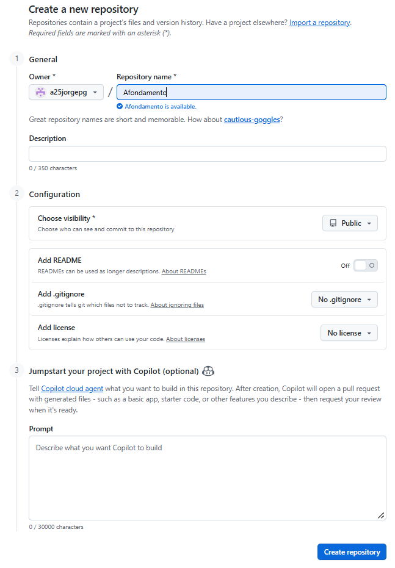
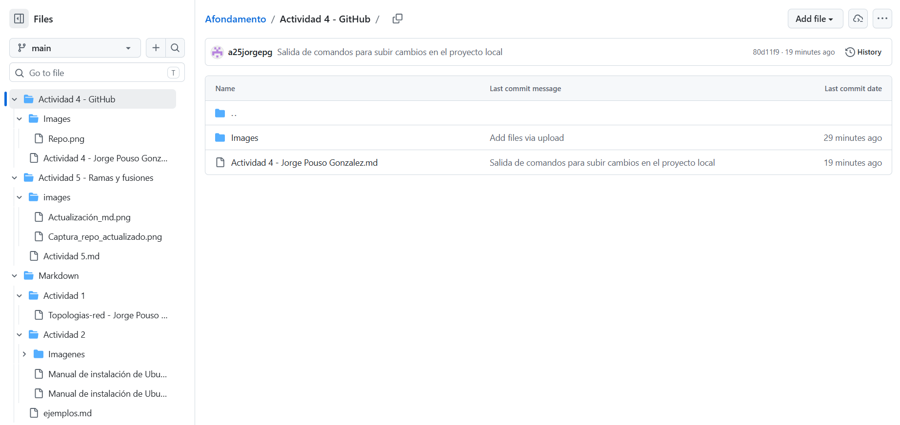

# Preparación 

## Ejecución del comando *git status*

````bash
PS C:\Visual_Studio\Afondamento> git status
On branch main
Your branch is up to date with 'origin/main'.

nothing to commit, working tree clean

````

## Ejecución del comando *git log --oneline*

````bash
PS C:\Visual_Studio\Afondamento> git log --oneline
98a62dd (HEAD -> main, origin/main, origin/HEAD)        new file:   Actividad 4 - GitHub/Actividad 4 - Jorge Pouso Gonzalez.md
2943201         new file:   "Actividad 5 - Ramas y fusiones/images/Actualizaci\303\263n_md.png"         new file:   Actividad 5 - Ramas y fusiones/images/Captura_repo_actualizado.png
5f7d1fa Actividad 5 acabada
76b84f3         new file:   Actividad 5 - Ramas y fusiones/Actividad 5.md       deleted:    git
5353e7c Añado recomendaciones de seguridad
94f6f42 Markdown guia acabado
aff3761 Tarea 2 de Markdown acabada
af6124d         deleted:    Markdown/Actividad 2/Imagenes/Captura de pantalla de 2026-10-14 11-00-15.png
d2c7bb4         new file:   Markdown/Actividad 2/Imagenes/nueva.png     modified:   "Markdown/Actividad 2/Manual de instalaci\303\263n de Ubuntu - Pouso Gonz\303\241lez, Jorge.md"
b14d39a modified:   Markdown/ejemplos.md
````

# Crear un repositorio en GitHub



> **Pregunta 1.** ¿Qué diferencia existe entre el repositorio local de tu ordenador y el repositorio remoto que acabas de crear?

El repositorio local solo se puede acceder y trabajar en el desde la máquina donde se almacena. El repositorio remoto puede clonarse y trabajar en el desde culaquier equipo.

# Conectar el repositorio local con GitHub

## Ejecución de comando *git remote add origin*
````bash
PS C:\Visual_Studio\Afondamento> git remote add origin https://github.com/a25jorgepg/Afondamento.git
PS C:\Visual_Studio\Afondamento> 
````
## Ejecución de comando *git remote -v*

````bash
PS C:\Visual_Studio\Afondamento> git remote -v 
origin  https://github.com/a25jorgepg/Afondamento.git (fetch)
origin  https://github.com/a25jorgepg/Afondamento.git (push)
PS C:\Visual_Studio\Afondamento> 
````

> **Pregunta 2.** ¿Qué representa origin en Git?

Origin representa el repositorio remoto central alojado en los servidores de GitHub

# Publicar el proyecto

## Consulta de la rama de trabajo

````bash
PS C:\Visual_Studio\Afondamento> git branch --show-current
master
PS C:\Visual_Studio\Afondamento> 
````
## Publicación de la rama actual

````bash
PS C:\Visual_Studio\Afondamento> git push -u origin HEAD
Enumerating objects: 46, done.
Counting objects: 100% (46/46), done.
Delta compression using up to 12 threads
Compressing objects: 100% (45/45), done.
Writing objects: 100% (46/46), 14.78 MiB | 5.82 MiB/s, done.
Total 46 (delta 0), reused 0 (delta 0), pack-reused 0 (from 0)
To https://github.com/a25jorgepg/Afondamento.git
 * [new branch]      HEAD -> master
branch 'master' set up to track 'origin/master'.
PS C:\Visual_Studio\Afondamento> 
````

> **Pregunta 3.** ¿Qué función realiza el comando git push?
El comando *git push* sube los commits realizados en local al repositorio remoto 

# Modificar el proyecto y actualizar GitHub

## Git status + git add . + git commit

````bash
PS C:\Visual_Studio\Afondamento> git status
On branch master
Your branch is up to date with 'origin/master'.

Changes not staged for commit:
  (use "git add <file>..." to update what will be committed)
  (use "git restore <file>..." to discard changes in working directory)
        modified:   Actividad 4 - GitHub/Actividad 4 - Jorge Pouso Gonzalez.md
        modified:   "Markdown/Actividad 1/Topologias-red - Jorge Pouso Gonz\303\241lez.md"

no changes added to commit (use "git add" and/or "git commit -a")
````

# Modificar proyecto y actualizar GitHub

````bash
PS C:\Visual_Studio\Afondamento> git status 
On branch main
Your branch is up to date with 'origin/main'.

Changes not staged for commit:
  (use "git add <file>..." to update what will be committed)
  (use "git restore <file>..." to discard changes in working directory)
        modified:   Actividad 4 - GitHub/Actividad 4 - Jorge Pouso Gonzalez.md
        modified:   "Markdown/Actividad 1/Topologias-red - Jorge Pouso Gonz\303\241lez.md"

no changes added to commit (use "git add" and/or "git commit -a")
PS C:\Visual_Studio\Afondamento> git add .
PS C:\Visual_Studio\Afondamento> git commit -m 'Añado información del proyecto'
[main 3ec527c] Añado información del proyecto
 2 files changed, 11 insertions(+), 1 deletion(-)
PS C:\Visual_Studio\Afondamento> git push
Enumerating objects: 13, done.
Counting objects: 100% (13/13), done.
Delta compression using up to 12 threads
Compressing objects: 100% (7/7), done.
Writing objects: 100% (7/7), 773 bytes | 773.00 KiB/s, done.
Total 7 (delta 2), reused 0 (delta 0), pack-reused 0 (from 0)
remote: Resolving deltas: 100% (2/2), completed with 2 local objects.
To https://github.com/a25jorgepg/Afondamento.git
   346b13e..3ec527c  main -> main
PS C:\Visual_Studio\Afondamento> 
````
> **Pregunta 4.** ¿Por qué es necesario ejecutar git push después de realizar un commit local?
Porque con el *git push*, los cambios realizados en local, se sincronizan con el repositorio remoto

# Descargar cambios desde GitHub

## Git pull
````bash
PS C:\Visual_Studio\Afondamento> git pull
Updating 81ddd36..a5ac82d
Fast-forward
 .../Actividad 1/Topologias-red - Jorge Pouso Gonz\303\241lez.md"    | 6 +++---
 1 file changed, 3 insertions(+), 3 deletions(-)
PS C:\Visual_Studio\Afondamento> 
````

> **Pregunta 5.** ¿Qué diferencia existe entre git push y git pull?
La diferenecia principal radica en la dirección en la que viajan los cambios:

- Con el *git push*, los cambios van del repositorio local al repositotio remoto
- Con el *git pull*, los cambios van del repositorio remoto al local

# Clonar un repositorio

## Git clone
````bash
PS C:\VSCode> git clone https://github.com/a25jorgepg/Afondamento.git
Cloning into 'Afondamento'...
remote: Enumerating objects: 74, done.
remote: Counting objects: 100% (74/74), done.
remote: Compressing objects: 100% (65/65), done.
remote: Total 74 (delta 12), reused 21 (delta 8), pack-reused 0 (from 0)
Receiving objects: 100% (74/74), 14.79 MiB | 10.25 MiB/s, done.
Resolving deltas: 100% (12/12), done.
PS C:\VSCode> 
````

## Git log --oneline
````bash
PS C:\VSCode\Afondamento> git log --oneline
a5ac82d (HEAD -> main, origin/main, origin/HEAD) Futuras Mejoras desde GitHub
81ddd36 .
debdef7 Mejoras futuras desde GitHub
80d11f9 Salida de comandos para subir cambios en el proyecto local
3ec527c Añado información del proyecto
346b13e Add files via upload
PS C:\VSCode\Afondamento> 
````
> **Pregunta 6.** ¿Qué diferencia existe entre clonar un repositorio con git clone y descargar sus archivos como ZIP desde GitHub?
Que con la clonación, no solo obtienes el historial de cambios, sino que también tiene la carpeta oculta *.git*, por lo que puedes actualizarlo más fácilemente en el futuro.

El ZIP de los archivos, solo son los arcivos, no tiene el hitorial de cambios ni la carpeta *.git*, por lo que cada vez que se quiera actualizar, habrá que descargar el ZIP con los cambios o clonar el repositorio.

# Dirección del repostorio

[Enlace al repositorio](https://github.com/a25jorgepg/Afondamento/tree/main)

# Captura de pantalla con los archivos del repositorio

