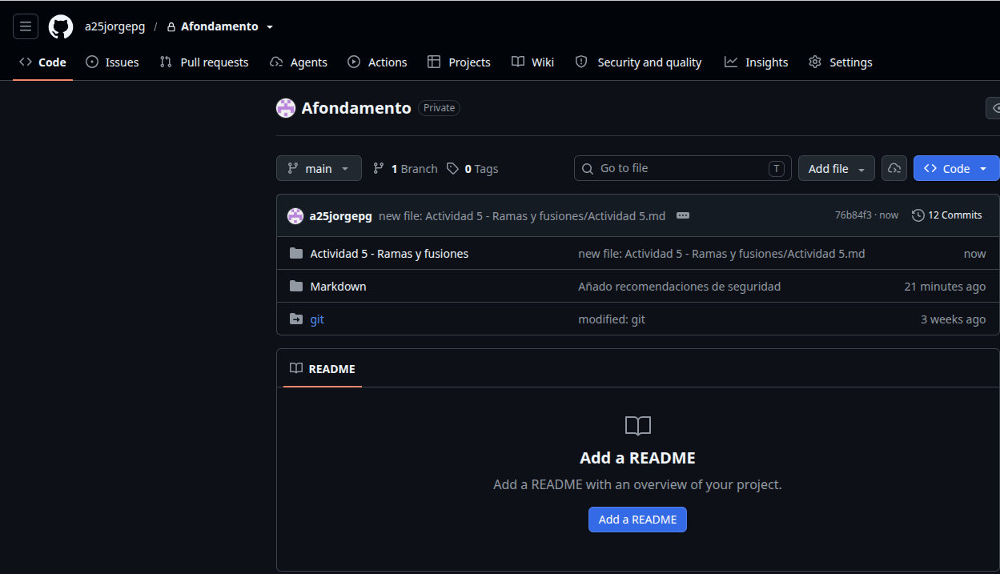
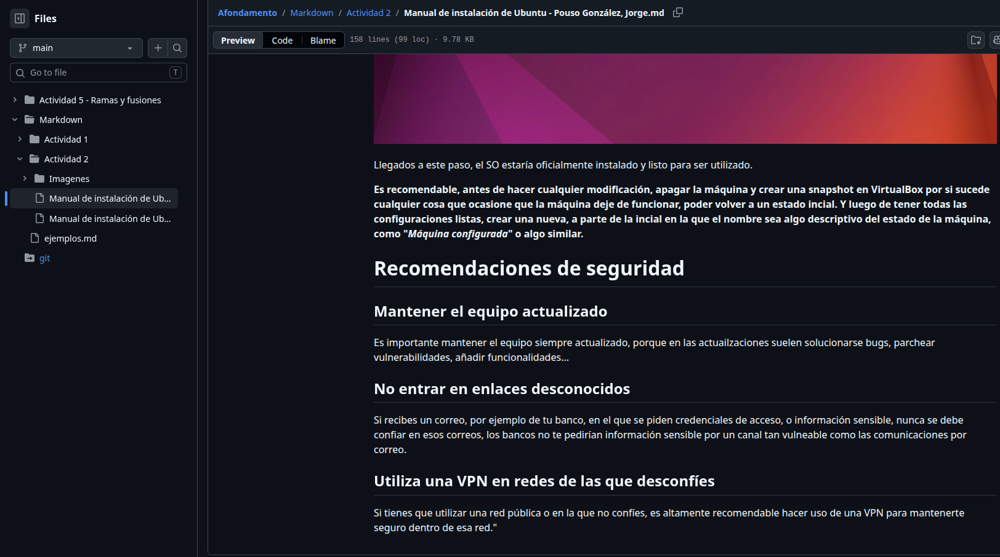

# Actividad 5 - Ramas y fusiones
---
## Paso 1 - Preparación del repositorio
```bash
a25jorgepg@a26eql04:~/Afondamento$ git status
En la rama main
Tu rama está actualizada con 'origin/main'.

nada para hacer commit, el árbol de trabajo está limpio
a25jorgepg@a26eql04:~/Afondamento$ git branch
* main
a25jorgepg@a26eql04:~/Afondamento$ git log --oneline
94f6f42 (HEAD -> main, origin/main, origin/HEAD) Markdown guia acabado
aff3761 Tarea 2 de Markdown acabada
af6124d         deleted:    Markdown/Actividad 2/Imagenes/Captura de pantalla de 2026-10-14 11-00-15.png
d2c7bb4         new file:   Markdown/Actividad 2/Imagenes/nueva.png     modified:   "Markdown/Actividad 2/Manual de instalaci\303\263n de Ubuntu - Pouso Gonz\303\241lez, Jorge.md"
b14d39a modified:   Markdown/ejemplos.md
6c37133 prueba
e6250cd modified:   git
262bdb6 Pruebas de git (local) + Avanzar no manual de instalación de Ubuntu (Acabar)
09ef426 1º Punto casi acabado
662ad2d Add files via upload
```
> **PREGUNTA 1.** ¿Como puedes identificar la rama en la que estás trabajando actualmente?

Con el comando *git branch*, al ejecutarlo, aparece una lista con las ramas del proyecto. La rama con la que trabajas en ese momento, se destaca con un asterisco.

Por ejemplo:

```bash
a25jorgepg@a26eql04:~/Afondamento$ git branch
  main
* mejoras
```

En este caso, la rama con la que se estaría trabajando sería la de mejoras.

## Paso 2 - Crear una rama nueva
```bash
a25jorgepg@a26eql04:~/Afondamento$ git branch mejoras
a25jorgepg@a26eql04:~/Afondamento$ git switch mejoras
Cambiado a rama 'mejoras'
a25jorgepg@a26eql04:~/Afondamento$ git branch
  main
* mejoras
```

> **Pregunta 2.** ¿Que diferencia existe entre *git branch mejoras* y *git switch -c mejoras*?

Con *git branch mejoras*, solo se crea la rama "mejoras", pero sigues en la misma rama en la que estabas trabajando, sin cambiarte.

Con *git switch -c mejoras*, se crea la rama "mejoras" y pasas a trabajar en ella la mismo tiempo, no es necesario crear la rama y cambiarte en dos ejecuciones de comando.


## Paso 3 - Modificar el documento
```bash
a25jorgepg@a26eql04:~/Afondamento$ git switch mejoras
M       "Markdown/Actividad 2/Manual de instalaci\303\263n de Ubuntu - Pouso Gonz\303\241lez, Jorge.md"
D       git
Cambiado a rama 'mejoras'
a25jorgepg@a26eql04:~/Afondamento$ git add "Markdown/Actividad 2/Manual de instalación de Ubuntu - Pouso González, Jorge.md"
a25jorgepg@a26eql04:~/Afondamento$ git commit -m "Añado recomendaciones de seguridad"
[mejoras 5353e7c] Añado recomendaciones de seguridad
 1 file changed, 19 insertions(+)
```

## Paso 4 - Volver a la rama principal
```bash
a25jorgepg@a26eql04:~/Afondamento$ git switch main
D       git
Cambiado a rama 'main'
Tu rama está actualizada con 'origin/main'.
```

> **Pregunta 3.** ¿Aparece la sección de recomendaciones de seguridad que acabas de añadir? ¿Por qué?

No, porque los cambios y el commit se realizaron en la branch de mejoras, al volver a main no están los cambios, porque cada branch es como otro proyecto distinto teniendo la estructura de base del commit en el que se creó.

### Log de la branch *main*

```bash
a25jorgepg@a26eql04:~/Afondamento$ git log --oneline
94f6f42 (HEAD -> main, origin/main, origin/HEAD) Markdown guia acabado
aff3761 Tarea 2 de Markdown acabada
af6124d         deleted:    Markdown/Actividad 2/Imagenes/Captura de pantalla de 2026-10-14 11-00-15.png
d2c7bb4         new file:   Markdown/Actividad 2/Imagenes/nueva.png     modified:   "Markdown/Actividad 2/Manual de instalaci\303\263n de Ubuntu - Pouso Gonz\303\241lez, Jorge.md"
b14d39a modified:   Markdown/ejemplos.md
6c37133 prueba
e6250cd modified:   git
262bdb6 Pruebas de git (local) + Avanzar no manual de instalación de Ubuntu (Acabar)
09ef426 1º Punto casi acabado
662ad2d Add files via upload
```

### Log de la branch *mejoras*

```bash
a25jorgepg@a26eql04:~/Afondamento$ git switch mejoras 
D       git
Cambiado a rama 'mejoras'
a25jorgepg@a26eql04:~/Afondamento$ git log --oneline
5353e7c (HEAD -> mejoras) Añado recomendaciones de seguridad
94f6f42 (origin/main, origin/HEAD, main) Markdown guia acabado
aff3761 Tarea 2 de Markdown acabada
af6124d         deleted:    Markdown/Actividad 2/Imagenes/Captura de pantalla de 2026-10-14 11-00-15.png
d2c7bb4         new file:   Markdown/Actividad 2/Imagenes/nueva.png     modified:   "Markdown/Actividad 2/Manual de instalaci\303\263n de Ubuntu - Pouso Gonz\303\241lez, Jorge.md"
b14d39a modified:   Markdown/ejemplos.md
6c37133 prueba
e6250cd modified:   git
262bdb6 Pruebas de git (local) + Avanzar no manual de instalación de Ubuntu (Acabar)
09ef426 1º Punto casi acabado
662ad2d Add files via upload
```
> **Pregunta 4.** ¿Aparece el último commit realizado en la rama mejoras dentro del historial de la rama principal?

No, por lo explicado anteriormente, cada branch sería como un proyecto diferente desde el cual el punto de partida el es estado de la rama *main* al momento de realizar el rama de *mejoras*

## Paso 5 - Fusionar ramas

```bash
a25jorgepg@a26eql04:~/Afondamento$ git switch main
D       git
Cambiado a rama 'main'
Tu rama está actualizada con 'origin/main'.
a25jorgepg@a26eql04:~/Afondamento$ git merge mejoras
Actualizando 94f6f42..5353e7c
Fast-forward
 "Markdown/Actividad 2/Manual de instalaci\303\263n de Ubuntu - Pouso Gonz\303\241lez, Jorge.md" | 20 +++++++++++++++++++-
 1 file changed, 19 insertions(+), 1 deletion(-)
a25jorgepg@a26eql04:~/Afondamento$ 
```
### Log de la bran *main* tras el merge

```bash
a25jorgepg@a26eql04:~/Afondamento$ git log --oneline
5353e7c (HEAD -> main, mejoras) Añado recomendaciones de seguridad
94f6f42 (origin/main, origin/HEAD) Markdown guia acabado
aff3761 Tarea 2 de Markdown acabada
af6124d         deleted:    Markdown/Actividad 2/Imagenes/Captura de pantalla de 2026-10-14 11-00-15.png
d2c7bb4         new file:   Markdown/Actividad 2/Imagenes/nueva.png     modified:   "Markdown/Actividad 2/Manual de instalaci\303\263n de Ubuntu - Pouso Gonz\303\241lez, Jorge.md"
b14d39a modified:   Markdown/ejemplos.md
6c37133 prueba
e6250cd modified:   git
262bdb6 Pruebas de git (local) + Avanzar no manual de instalación de Ubuntu (Acabar)
09ef426 1º Punto casi acabado
662ad2d Add files via upload
```

> **Pregunta 5.** ¿Qué ha ocurrido con el contenido del documento y con el historial después de realizar la fusión?

Que al hacer el *git merge mejoras* en la rama *main*, se juntan los dos estados de las ramas en la princiapl (*main*), lo que combina los cambios realizados en mejoras en la rama maestra.

## Paso 6 - Visualizar el historial

```bash
a25jorgepg@a26eql04:~/Afondamento$ git log --oneline --graph --all --decorate
* 5353e7c (HEAD -> main, mejoras) Añado recomendaciones de seguridad
* 94f6f42 (origin/main, origin/HEAD) Markdown guia acabado
* aff3761 Tarea 2 de Markdown acabada
* af6124d       deleted:    Markdown/Actividad 2/Imagenes/Captura de pantalla de 2026-10-14 11-00-15.png
* d2c7bb4       new file:   Markdown/Actividad 2/Imagenes/nueva.png     modified:   "Markdown/Actividad 2/Manual de instalaci\303\263n de Ubuntu - Pouso Gonz\303\241lez, Jorge.md"
* b14d39a modified:   Markdown/ejemplos.md
* 6c37133 prueba
* e6250cd modified:   git
* 262bdb6 Pruebas de git (local) + Avanzar no manual de instalación de Ubuntu (Acabar)
* 09ef426 1º Punto casi acabado
* 662ad2d Add files via upload
```

> **Pregunta 6.** ¿Por qué crees que puede ser útil trabajar con ramas en un proyecto desarrollado por varias personas?

Porque así, cada persona puede trabajar en su propia parte del proyecto sin pisar el trabajo de los demás, y sin que los demás pisen el suyo, evitando posibles errores

## Paso 7 - Sinconización con GitHub

```bash
a25jorgepg@a26eql04:~/Afondamento$ git push
Enumerando objetos: 9, listo.
Contando objetos: 100% (9/9), listo.
Compresión delta usando hasta 24 hilos
Comprimiendo objetos: 100% (5/5), listo.
Escribiendo objetos: 100% (5/5), 1015 bytes | 1015.00 KiB/s, listo.
Total 5 (delta 2), reusados 0 (delta 0), pack-reusados 0
remote: Resolving deltas: 100% (2/2), completed with 2 local objects.
To https://github.com/a25jorgepg/Afondamento.git
   94f6f42..5353e7c  main -> main
```
### Comprobación de modificaciones en el documento



