# Instalación de Ubuntu 24.04 en VirtualBox
---
## Índice

- [Instalación de Ubuntu 24.04 en VirtualBox](#instalación-de-ubuntu-2404-en-virtualbox)
  - [Índice](#índice)
  - [1. Obtención de la imagen ISO](#1-obtención-de-la-imagen-iso)
  - [2. Creación de la máquina virtual](#2-creación-de-la-máquina-virtual)
  - [3. Instalación de la máquina virtual](#3-instalación-de-la-máquina-virtual)
- [**Recomendaciones de seguridad**](#recomendaciones-de-seguridad)
  - [Mantener el equipo actualizado](#mantener-el-equipo-actualizado)
  - [No entrar en enlaces desconocidos](#no-entrar-en-enlaces-desconocidos)
  - [Utiliza una VPN en redes de las que desconfíes](#utiliza-una-vpn-en-redes-de-las-que-desconfíes)
---
## 1. Obtención de la imagen ISO

Para obtener la imagen ISO de Ubuntu, vamos a nuestro buscador de preferencia y en la barra de búsqueda introducimos *Ubuntu 24.04 ISO* y entramos al enlace que dice *Ubuntu 24.04 (Noble Numbat)*.

<small>El resultado puede variar, tanto la vesión de Ubuntu 24.04.x, como el nombre que recibe la release</small>

**Es importante asegurarse de que el enlace es original, porque existe el riesgo de descargar una imagen infectada en caso de no obtener la imagen de un enlace lícito.**

Una vez accedido al enlace de descaga de la imagen, nos recibiría una web como esta:

En el primer elemento de la tabla, donde pone *Desktop Image*, pinchamos en el enlace de la columna de a derecha, donde pone 64-bit PC (AMD64) desktop image, o pinchando en este [enlace](https://releases.ubuntu.com/noble/ubuntu-24.04.5.1-desktop-amd64.iso).

Pinchando en el enlace, comenzaría la descarga, la cuál será visible pulsando Ctrl + j, para ir al administrado de descargas, viéndose algo así:

Una vez descargada la imagen ISO, deberemos localizarla en nuestro equipo. **Por defecto se encuentra en la carpeta *Descargas***

---

## 2. Creación de la máquina virtual

Para crear la máquina virtual, accederemos al *VirtualBox*. Donde nos recibirá una página de inicio como esta:

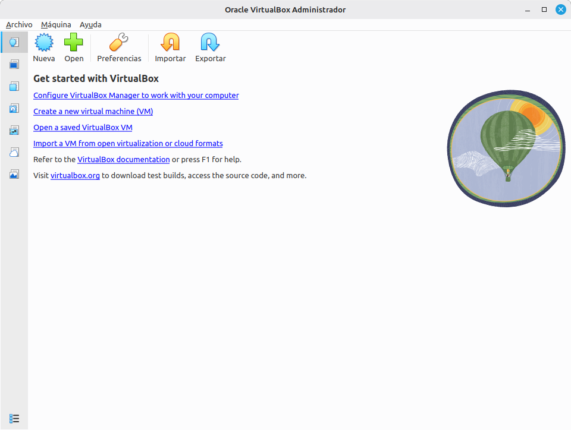

En el panel superior, podemos ver una serie de opciones, algo similiar a esto 

Pinchamos en la estrella azul que pone '*nueva*', y se desplegará un menú de configuración inicial con varios campos. Algo similar a esto:

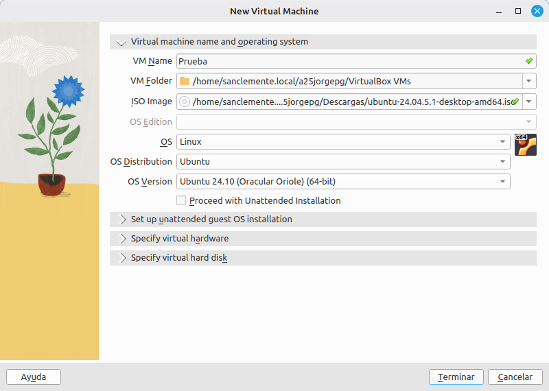

Ahora cubriremos todos los campos ajustándose a nuestras necesidades. Los diferentes campos del formulario contendrán lo siguiente:

|      Campo      |                          Información                           |
| :-------------: | :------------------------------------------------------------: |
|     VM Name     |                  Nombre de la máquina virtual                  |
|    VM Folder    |    Ruta donde se guardará la carpeta con los datos de la MV    |
|    ISO Image    | Imagen ISO con el Sistema Operativo que queremos usar en la MV |
|   OS Edition    |                 Versión del sistema operativo                  |
|       OS        |                       Sistema Operativo                        |
| OS Distribution |      Distribución del SO a utilizar (Para sistemas linux)      |
|   OS Version    |                 Versión del sistema operativo                  |

> ¡***IMPORTANTE***! Desmarcar la opción *Proceed with Unattented installation*, sin esta opción desmarcada no podremos hacer nada de la seguiente configuración

En el siguiente apartado de *Specify virtual hardware* seleccionaremos los recursos de RAM y núcleos de procesador que queremos que utilice nuestra MV.

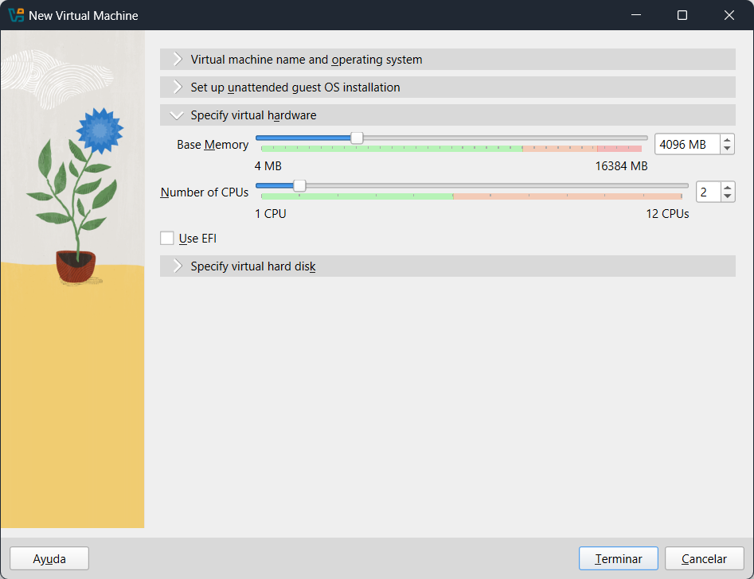

|     Nombre     |                           Uso                            |
| :------------: | :------------------------------------------------------: |
|  Base Memory   | Cantidad de memoria RAM que utilizará como máximo la MV. |
| Number of CPUs |       Cantidad de núcleos que puede utilizar la MV       |

- En la selección de cantidad de la memoria RAM se divide en 2 zonas diferenciadas por colores (Verde y Rojo):
  - La zona roja es donde se vuelve contraproducente asignar tanta RAM a la MV, porque la máqunina anfitriona se queda con poca memoria y esto puede ocasionar cuelgues en la anfitriona, una notoria falta de rendimiento y en determinados casos, pantallazos azules.
  - La zona verde es donde la máquina anfitriona tiene suficiente memoria para funcionar correctamente. Este nivel es el recomendado para las MV. Pero hai que tener en cuenta cuántas MV se tendrán funcionando simultánemante, porque el uso de RAM de las MV se suma, por lo que si se tiene previsto tener varias MV arrancadas a la vez es mejor que estas tengan una cantidad de RAM menor.

En nuestro caso, la configuración de base de ubuntu solo requiere 2 GB de RAM por defecto para que funcione sin problemas, pero podemos subirlo a 4 GB si queremos asegurar un mejor rendimiento y fluidez. 

Por defecto los núcleos asignados a la máquina son 1 núcleo, pero por la misma razón que antes, podemos subirlo a 2 núcleos para un mejor desempeño.

**Cabe resaltar que esta parte de la configuración puede modificarse posteriormente con la MV apagada.**

Marcamos la casilla de *Habilitar EFI*

Por último, tenemos el apartado de *Specify virtual hard disk*. Aquí seleccionaremos el tamaño máximo de la MV.

El formulario sería algo similar al siguiente:

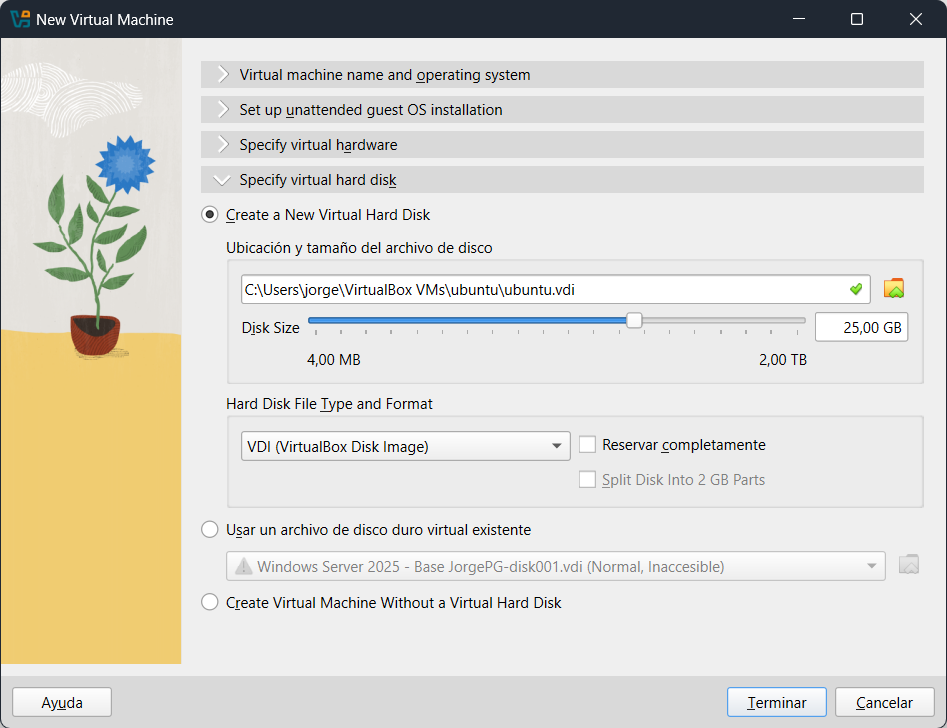

En este apartado tenemos que el tamaño que puede tener como máximo la MV es de 25 GB por defecto, aquí podemos ajustarlo a nuestras necesidades.

**¡IMPORTANTE! No marcar la opción de *Reservar disco completamente***. Si se marca, al crear la máquina virtual, se eliminarán esos 25 GB (O el tamaño configurado) de nuestro disco duro, porque el archivo de la máquina virtual pasa a tener el tamaño indicado en este formulario. De la otra manera, el tamaño de la MV aumenta de manera dinámica en función del contenido y aplicaciones o servicios instalados en la misma.

---

## 3. Instalación de la máquina virtual

Una vez configurada la máquina virtual, le damos a la opción *terminar* abajo a la derecha y se crearía la máquina virtual lista para arrancar.

En nuestro menú de VirtualBox debería de verse algo así:

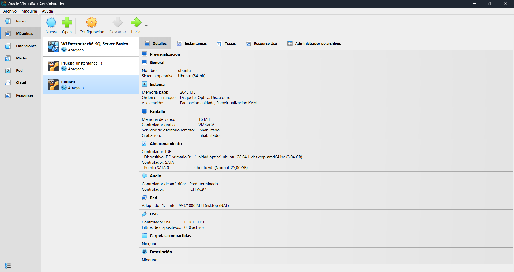

Hacemos doble click sobre la máquina que acabamos de crear y se empezará la ejecución. Aparecerá un panel lateral con una notificación de la MV se está arrancado

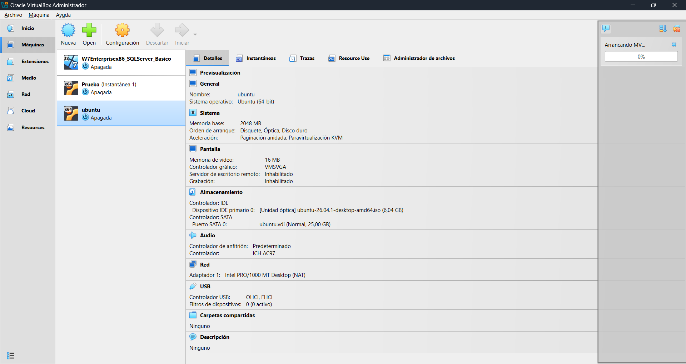

Una vez arrancada la máquina, aparecerá este menú:

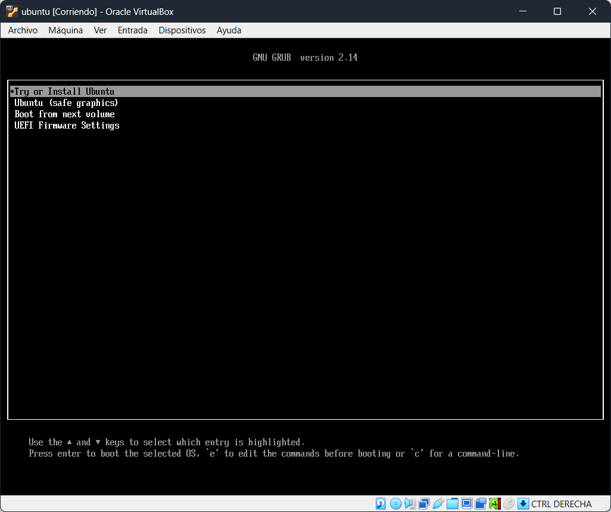

Aquí, pulsaremos *enter* para seleccionar la primera opción (*Try or Install Ubuntu*) y se procederá con el arranque inicial del SO

Después de un par de minutos de carga, la máquina inicia en el escritorio de ubuntu con el formulario de configuración incial del SO. Aquí haríamos la configuración inicial 

|                 Fase                 |                    Ejemplo                     |
| :----------------------------------: | :--------------------------------------------: |
|                Inicio                | 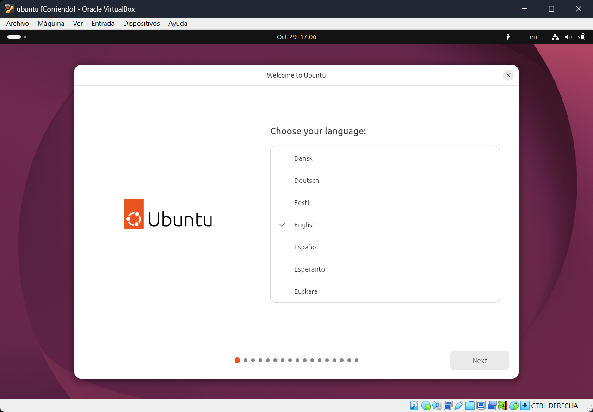 |
|            Accesibilidad             |      |
|       Districución del teclado       |          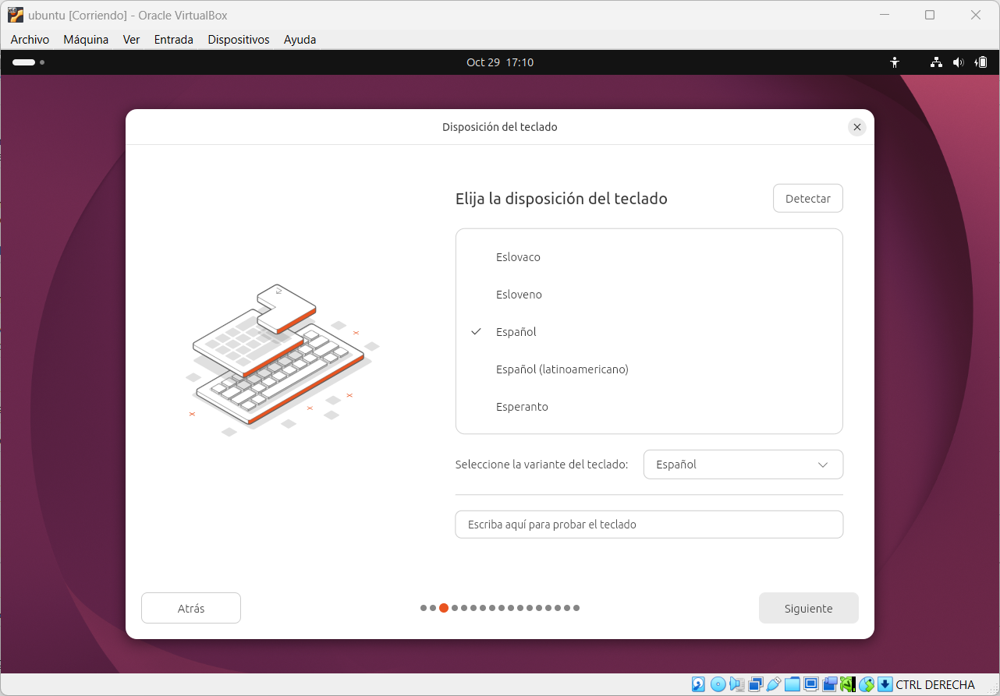           |
|         Configuración de Red         |            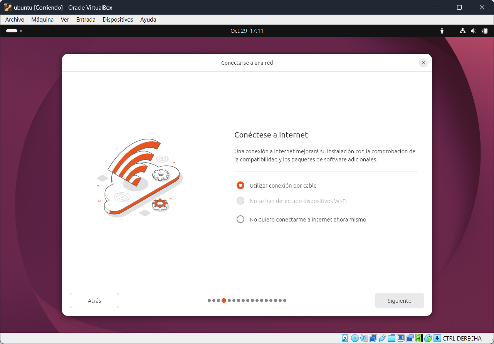             |
|         Tipo de instalación          |          |
|       Aplicaciones a instalar        |            |
| Aplicaciones de tereros (Drivers...) |    |
|          Formateo de disco           |             |
|    Control de acceso (Contraseña)    |         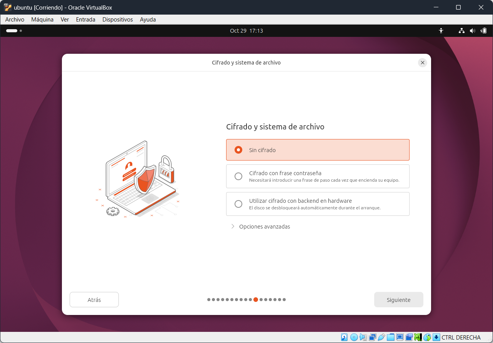          |
|  Nombre y credenciales del usuario   |           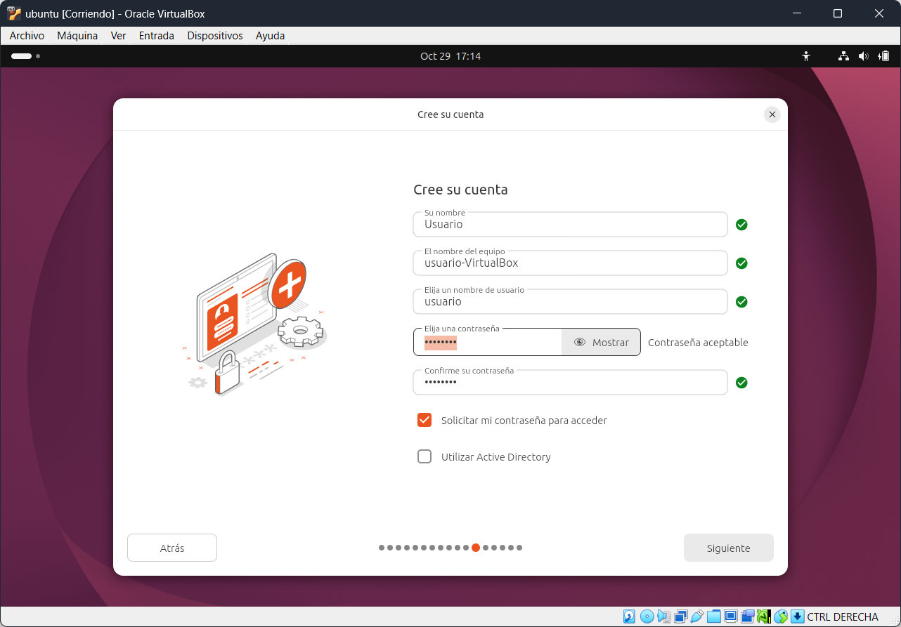           |
|      Selección de zona horaria       |              |
|       Resumen de configuración       |          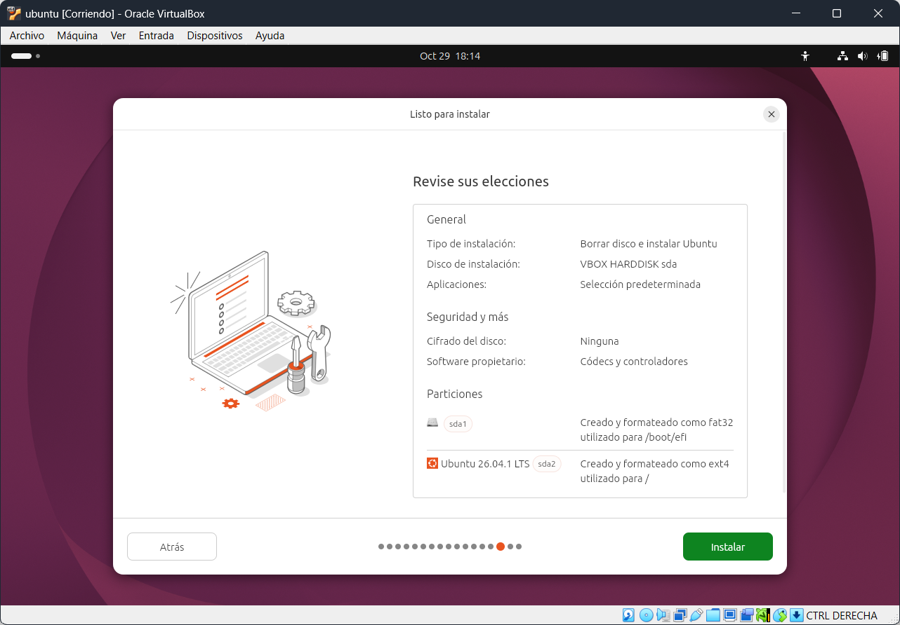           |
|     Inicio de instalación del SO     |        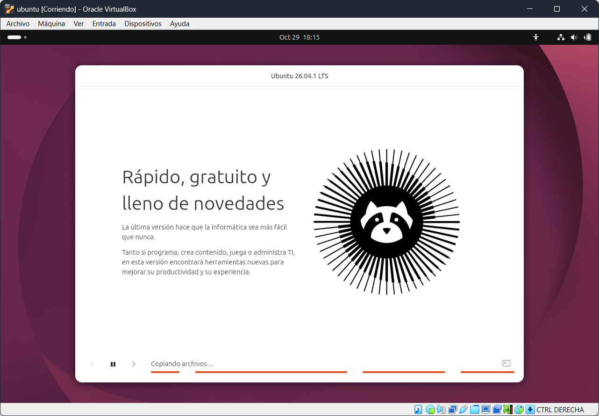        |

Después de un tiempo para la instalación del SO, al reiniciarse automáticamente, el resultado sería una pantalla similar a esta:

Llegados a este paso, el SO estaría oficialmente instalado y listo para ser utilizado.

**Es recomendable, antes de hacer cualquier modificación, apagar la máquina y crear una snapshot en VirtualBox por si sucede cualquier cosa que ocasione que la máquina deje de funcionar, poder volver a un estado incial. Y luego de tener todas las configuraciones listas, crear una nueva, a parte de la incial en la que el nombre sea algo descriptivo del estado de la máquina, como "*Máquina configurada*" o algo similar.**

# **Recomendaciones de seguridad**

## Mantener el equipo actualizado

Es importante mantener el equipo siempre actualizado, porque en las actuailzaciones suelen solucionarse bugs, parchear vulnerabilidades, añadir funcionalidades...

## No entrar en enlaces desconocidos

Si recibes un correo, por ejemplo de tu banco, en el que se piden credenciales de acceso, o información sensible, nunca se debe confiar en esos correos, los bancos no te pedirían información sensible por un canal tan vulneable como las comunicaciones por correo.

## Utiliza una VPN en redes de las que desconfíes

Si tienes que utilizar una red pública o en la que no confíes, es altamente recomendable hacer uso de una VPN para mantenerte seguro dentro de esa red."

